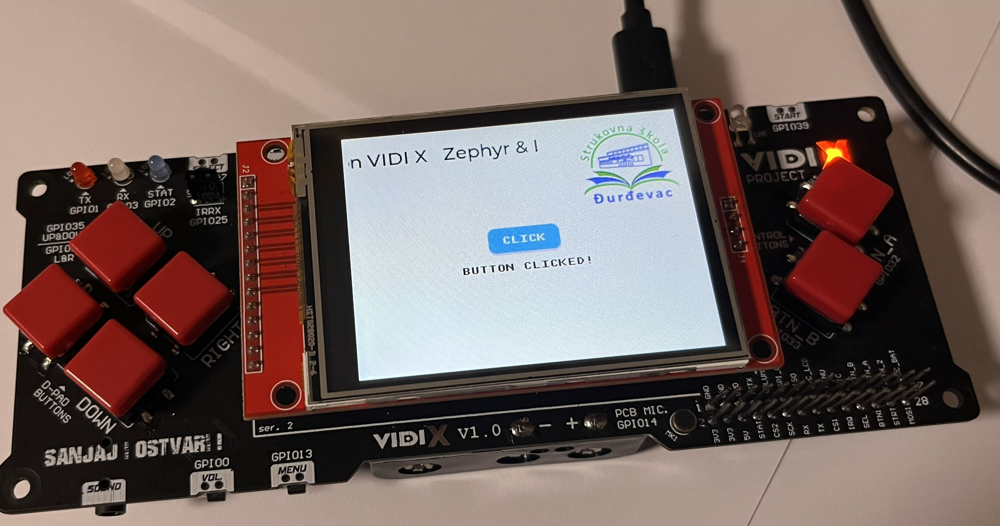

# VIDI X v1.0 — vlastita Zephyr board definicija



*Fotografija LVGL demonstracije na stvarnoj pločici VIDI X. 

## 1. Opis

Ovaj projekt donosi **vlastitu (*out-of-tree*) Zephyr board definiciju za VIDI X v1.0**, razvojnu pločicu s modulom **ESP32-WROVER-B**, te podršku za povezani **ILI9341 TFT zaslon** i **XPT2046 touch kontroler**. Konfiguracija je izrađena i ispitana sa sustavom **Zephyr RTOS v4.4.2**.

Cilj je **odvojiti opis hardvera od aplikacijskog koda**. Umjesto korištenja targeta `esp32_devkitc/esp32/procpu` i ponavljanja istih postavki u aplikacijskom overlayu, projekt koristi vlastiti target:

```text
vidi_x/esp32/procpu
```

Board definicija opisuje SoC, osnovnu memorijsku i konzolnu konfiguraciju, SPI veze, prikaz i unos dodirom. **LVGL aplikacija pritom ostaje zasebna** i koristi standardne Zephyrove Display i Input podsustave.

**Status projekta:** vlastiti target uspješno je prepoznat u Zephyr IDE-u, izgrađen, učitan i pokrenut na stvarnoj pločici. **Potvrđeni su ILI9341 prikaz, LVGL 9 sučelje, XPT2046 touch i pomični naslov** nakon ispravka aplikacijskog koda. Riječ je, međutim, o **početnom, neslužbenom BSP-u (Board Support Package)**, a ne o potpuno testiranoj podršci za sve periferije VIDI X-a.


## 2. Struktura projekta

Osnovni BSP paket sadrži:

```text
zephyr-vidi-x/
├── boards/
│   └── others/
│       └── vidi_x/
│           ├── board.cmake
│           ├── board.yml
│           ├── Kconfig.vidi_x
│           ├── vidi_x_procpu_defconfig
│           ├── vidi_x_procpu.dts
│           └── vidi_x-pinctrl.dtsi
├── images/
│   └── demo.jpg
├── src/
│   ├── main.c
│   ├── logo.c
│   └── logo.h
├── .gitignore
├── CMakeLists.txt
├── LICENSE
├── prj.conf
└── README.md
```

| Datoteka | Namjena |
|---|---|
| `board.yml` | Registracija pločice i dostupnog ESP32 SoC-a. |
| `Kconfig.vidi_x` | Odabir SoC konfiguracije i PROCPU jezgre. |
| `vidi_x_procpu_defconfig` | Osnovne postavke pločice: konzola, GPIO, sistemski heap i starija revizija ESP32-a. |
| `vidi_x_procpu.dts` | Hardverski opis: UART, SPI, ILI9341, XPT2046 i LVGL input čvor. |
| `vidi_x-pinctrl.dtsi` | Povezivanje UART0 i SPI3 signala s GPIO pinovima. |
| `board.cmake` | Uključivanje standardne Espressif podrške za flashanje. |

**BSP paket nije samostalna LVGL aplikacija.** Datoteke `src/main.c`, `src/logo.c`, `src/logo.h`, `prj.conf` i aplikacijski `CMakeLists.txt` pripadaju projektu koji koristi ovu pločicu. Ako objavljuješ i demonstraciju na GitHubu, dodaj ih u isti repozitorij ili u zaseban direktorij s primjerom.

## 3. Hardversko povezivanje

### ILI9341 TFT zaslon

| Signal TFT modula | ESP32 GPIO | Namjena |
|---|---|---|
| `SCK` | GPIO18 | SPI takt |
| `MOSI` / `SDI` | GPIO23 | SPI podaci prema zaslonu |
| `MISO` | GPIO19 | Zajednička SPI sabirnica |
| `CS` | GPIO5 | Odabir ILI9341 kontrolera |
| `D/C` | GPIO21 | Odabir naredbi i podataka |
| `RESET` | Nije dodijeljen GPIO22 | BSP ne koristi `reset-gpios` na GPIO22 jer je ta linija na VIDI X-u povezana s drugim sklopovljem. |

Fizička rezolucija je **240 × 320 piksela**, a konfiguracija koristi `rotation = <270>` i `h-mirror` za željenu orijentaciju prikaza. Ovisno o modulu i usklađenosti dodirnih koordinata, kalibraciju treba dodatno provjeriti.

### XPT2046 touch kontroler

| Signal touch modula | ESP32 GPIO | Namjena |
|---|---|---|
| `T_CLK` | GPIO18 | Zajednički SPI takt |
| `T_DIN` | GPIO23 | SPI MOSI |
| `T_DO` | GPIO19 | SPI MISO |
| `T_CS` | GPIO4 | Odabir XPT2046 kontrolera |
| `T_IRQ` | **GPIO12** | Signal prekida dodira na izvornoj vezi VIDI X-a |

ILI9341 i XPT2046 koriste **istu SPI3 sabirnicu**, ali svaki ima zaseban `CS` signal. Konfiguracija s vanjskom vezom `T_IRQ → GPIO32`, ranije eksperimentalno isprobana, **nije dio ovoga BSP-a niti je potvrđena kao funkcionalna zamjena**.

### Mikroprekidači i ograničenje GPIO12

Za korištenu konfiguraciju provjerene su sljedeće veze prekidača VIDI X-a:

| Prekidač | Postavka / napomena |
|---|---|
| `VSPI_CS0` | `GAME USE` — LCD CS |
| `D/C_LCD` | `GAME USE` — LCD D/C |
| `VSPI_CS2` | `GAME USE` — touch CS |
| `TOUCH_IRQ` | `USE EXP.` pri uključivanju i resetiranju bilo je potrebno u ranijim testovima za pouzdano pokretanje. |

**GPIO12 je *strapping* pin klasičnog ESP32-a.** U ranijim testovima uređaj se mogao neuspješno pokretati ako je `TOUCH_IRQ` bio povezan pri resetiranju; nakon pokretanja touch je proradio pri prebacivanju `TOUCH_IRQ` na `GAME USE`. Novi BSP **potvrđeno obrađuje touch događaje**, ali to samo po sebi **ne dokazuje da je problem hladnog pokretanja riješen**.

Prebacivanje prekidača pod napajanjem korišteno je dijagnostički; **nije preporučena trajna procedura za nastavu ili gotov uređaj**. Za pouzdanu primjenu potrebno je posebno provjeriti ponašanje pri hladnom startu i odabrati odgovarajuće hardversko ili upravljačko rješenje.

## 4. Devicetree i Kconfig

U `vidi_x_procpu.dts` konfigurirani su UART0 i SPI3 te čvorovi ILI9341 i XPT2046. Svojstvo `zephyr,display` upućuje na zaslon, a čvor kompatibilan sa `zephyr,lvgl-pointer-input` povezuje XPT2046 s LVGL ulaznim događajima.

Datoteka `vidi_x-pinctrl.dtsi` određuje **SPI3 SCK = GPIO18, MOSI = GPIO23 i MISO = GPIO19**.

Ključne postavke u `vidi_x_procpu_defconfig`:

```ini
CONFIG_CONSOLE=y
CONFIG_SERIAL=y
CONFIG_UART_CONSOLE=y
CONFIG_GPIO=y
CONFIG_ESP32_USE_UNSUPPORTED_REVISION=y
CONFIG_HEAP_MEM_POOL_SIZE=8192
```

**`CONFIG_HEAP_MEM_POOL_SIZE=8192` obavezna je potvrđena dopuna ove konfiguracije.** Prvi build novog targeta prošao je konfiguraciju i kompilaciju, ali je povezivanje završilo pogreškama `undefined reference to 'k_malloc'` i `undefined reference to 'k_calloc'`. Nakon uključivanja sistemskog heap-a od **8 KiB**, build je uspješno završio i aplikacija je pokrenuta na pločici.

To nije isto što i LVGL-ov memorijski bazen (`CONFIG_LV_Z_MEM_POOL_SIZE`), koji se i dalje konfigurira u aplikaciji.

`CONFIG_ESP32_USE_UNSUPPORTED_REVISION=y` omogućuje pokretanje na ispitivanom primjerku koji prijavljuje stariju **ESP32 silicon revision 1**. Takva revizija nema punu službenu podršku u korištenoj konfiguraciji Zephyra; ova opcija nije jamstvo rada svih funkcija.

**Aplikacija** svojim `prj.conf` i dalje omogućuje, prema potrebi, `CONFIG_SPI`, `CONFIG_DISPLAY`, `CONFIG_MIPI_DBI`, `CONFIG_ILI9341`, `CONFIG_LVGL`, `CONFIG_INPUT`, `CONFIG_INPUT_XPT2046` i `CONFIG_LV_Z_POINTER_INPUT`. Board definicija nije zamjena za aplikacijsku konfiguraciju.

### Flash, PSRAM i ostale periferije

Korišteni fizički modul nosi oznaku **ESP32-WROVER-B**, dok se početna softverska SoC konfiguracija oslanja na `SOC_ESP32_WROVER_E_N4R8`. U prethodnim ispisima detektirano je **8 MiB flash memorije**, a zaglavlje slike navodilo je **4 MiB**. Stvarni kapaciteti, particije i upotreba PSRAM-a još **nisu do kraja provjereni**; ne mijenjaj particije samo na temelju ovih podataka.

U DTS-u su prisutni i čvorovi za pojedine ESP32 funkcije poput Wi-Fi-ja, Bluetootha i generatora slučajnih brojeva, ali **njihova funkcionalnost nije time automatski verificirana**. I²C je trenutačno onemogućen. Ostale specifične periferije VIDI X-a, kao što su tipke, SD kartica i drugi priključci, trebaju dodatni opis i zasebne testove.

## 5. Ugradnja u aplikacijski projekt

### Preduvjeti

- Zephyr workspace s **Zephyrom v4.4.2**, odgovarajućim SDK-om i aktiviranim Python virtualnim okruženjem.
- Funkcionalan LVGL projekt s datotekama `main.c`, `logo.c`, `logo.h`, `prj.conf` i `CMakeLists.txt`.
- VIDI X v1.0 i spojeni TFT/touch modul odgovarajuće vrste.
- Sigurnosna kopija prethodno funkcionalnog projekta.

U korijenu aplikacije očekuje se sljedeća struktura:

```text
04_VIDI_X_ili9341_xpt2046_lvgl/
├── boards/
│   └── others/
│       └── vidi_x/
│           ├── board.yml
│           ├── Kconfig.vidi_x
│           ├── vidi_x_procpu_defconfig
│           ├── vidi_x_procpu.dts
│           ├── vidi_x-pinctrl.dtsi
│           └── board.cmake
├── src/
│   ├── main.c
│   ├── logo.c
│   └── logo.h
├── images/
│   └── demo.jpg
├── prj.conf
├── CMakeLists.txt
└── README.md
```

**Postupak:**

1. Kopirati `boards/others/vidi_x/` u odgovarajući direktorij unutar projekta.
2. U `CMakeLists.txt` dodati `BOARD_ROOT` **prije** poziva `find_package(Zephyr ...)`:

   ```cmake
   cmake_minimum_required(VERSION 3.20.0)
   list(APPEND BOARD_ROOT ${CMAKE_CURRENT_SOURCE_DIR})
   find_package(Zephyr REQUIRED HINTS $ENV{ZEPHYR_BASE})
   ```

   Ostatak postojeće datoteke, uključujući `project(...)` i `target_sources(...)`, treba zadržati.
3. Za novi target ne treba dodatno uključivati stari `esp32_devkitc.overlay` ili drugi overlay koji ponovno definira isti LCD/touch hardver.
4. Zadržati aplikacijske LVGL i Input postavke u `prj.conf`.

**Važna razlika između alata:** u `CMakeLists.txt` i pri `west build` argument `BOARD_ROOT` upućuje na **korijen projekta koji sadrži mapu `boards/`**. U korištenom **Zephyr IDE-u**, prilikom odabira **Additional Board Directory**, bilo je potrebno odabrati **samu mapu `boards/`**. Nakon toga IDE je prepoznao `vidi_x/esp32/procpu`.

## 6. Izgradnja, flashanje i provjera

### Build

U PowerShellu, s aktiviranim Zephyr okruženjem, iz korijena aplikacije pokreni:

```powershell
west build -b vidi_x/esp32/procpu . -d C:/zb/vidix_custom -p always
```

Kratka izlazna putanja `C:/zb/vidix_custom` može pomoći izbjeći Windows ograničenja duljine putanja. U Zephyr IDE-u možeš odabrati target `vidi_x/esp32/procpu` i napraviti **Pristine Build**.

### Flash

Zatvoriti serijski monitor i, uz odgovarajući COM port, pokrenuti:

```powershell
west flash -d C:/zb/vidix_custom --esp-device COM10 --esp-baud-rate 115200
```

Flashanje se može izvršiti i iz Zephyr IDE-a.

### Serijski monitor

```powershell
python -m serial.tools.miniterm COM10 115200
```

## 9. Dokumentacija

**Korisne poveznice:**

- [Zephyr — Board Porting Guide](https://docs.zephyrproject.org/latest/hardware/porting/board_porting.html)
- [Zephyr — Application Development](https://docs.zephyrproject.org/latest/develop/application/index.html)
- [Zephyr — ESP32-DevKitC](https://docs.zephyrproject.org/latest/boards/espressif/esp32_devkitc/doc/index.html)
- [VIDI X — priručnik i radionice](https://hr.vidi-x.org/wp-content/uploads/2022/01/VIDI-X_radionice_v2-1.pdf)

---

*Ovaj README opisuje neslužbenu i eksperimentalnu Zephyr podršku razvijenu i ispitanu na konkretnom primjerku pločice VIDI X v1.0. Potvrđene su navedene funkcionalnosti; ostale periferije i posebne hardverske konfiguracije zahtijevaju zasebnu provjeru.*

## Licenca

Izvorni kod projekta distribuira se pod licencom Apache License 2.0. Detalji se nalaze u datoteci [LICENSE](LICENSE).

Projekt je neovisna, eksperimentalna Zephyr board definicija za VIDI X v1.0 i nije službena podrška proizvođača.

Logotipi, fotografije i drugi materijali trećih strana mogu podlijegati zasebnim autorskim pravima.